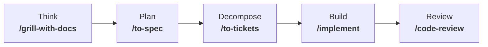

# sarthak-skills

Installs Sarthak's daily driver engineering workflow and desktop automation suite in one go.

## The Workflow



### 1. Direct Driver Skills (Explicitly Invoked)
- **`/grill-with-docs`**: Deep design interview that pressure-tests architecture and writes ADRs + `CONTEXT.md` glossary.
- **`/grill-me`**: Rapid-fire adversarial grilling on an idea, plan, or PR without document output.
- **`/to-spec`**: Synthesizes conversation context and requirements into a structured, approved specification.
- **`/to-tickets`**: Decomposes a spec into ordered, dependency-tracked tracer-bullet tickets.
- **`/implement`**: Implements tickets from specs adhering strictly to pre-agreed seams.
- **`/code-review`**: Runs dual parallel subagents auditing codebase standards and spec adherence.
- **`/desktop`**: Direct Linux Mint / Cinnamon X11 desktop control (`deskctl`).

### 2. Under-the-Hood Subskills (Automated)
- **`domain-modeling`**: Automatically invoked by `grill-with-docs` for glossary and ADR tracking.
- **`tdd`**: Automatically enforced during `/implement` for red-green-refactor cycles.
- **`diagnosing-bugs`**: Systematic 4-step root-cause diagnosis when test failures or regressions occur.
- **`desktop/*`**: Submodules (`apps`, `auth`, `core`, `security`, `tasks`) powering the desktop agent.

## Installation

Run from the project root:
```bash
curl -fsSL https://raw.githubusercontent.com/chill-czar/sarthak-skills/main/install.sh | bash
```

Or install globally across all workspaces:
```bash
curl -fsSL https://raw.githubusercontent.com/chill-czar/sarthak-skills/main/install.sh | bash -s -- -g
```

Or add via the `skills` CLI:
```bash
bunx skills add chill-czar/sarthak-skills -y
```
